# SaySo: a Direct Conversational Transaction Agent (DCTA)

**Speak your payments. Verify every detail. Stay in control.** Nothing moves without your say-so.

Tencent Cloud Hackathon 2026 · DBS track · Scenario 1 (voice-enabled payment and transaction, with KYC and basic risk control).

> **Simulated bank, synthetic data.** This is a hackathon prototype. It is not connected to DBS or to any real bank, PayNow, SGX, KYC or sanctions service. All accounts, payees, balances, share quotes and second-factor codes are synthetic. No real money moves.

[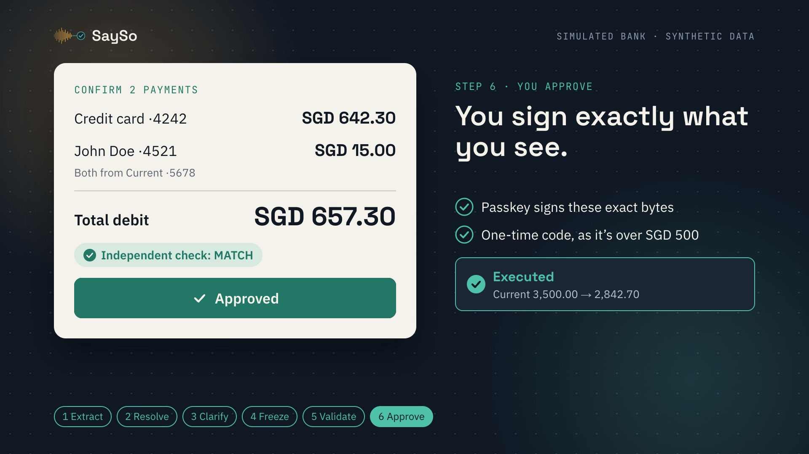](docs/launch/sayso-launch.mp4)

<p align="center"><a href="docs/launch/sayso-launch.mp4"><b>▶ Watch the 24-second launch video</b></a> · <a href="docs/launch/README.md">how it was made</a></p>

## What it is

SaySo is a payments feature for a bank's app. It lets a customer say or type routine payments in their own words, for example *"Send fifty bucks to Mum from my savings and twenty dollars to Ah Ma from savings"*. It turns them into one exact bundle of payments, which the customer checks and approves with a passkey (Touch ID). Two AI models read the request: one drafts it and a second checks the draft independently. Neither model can move money. Only a deterministic gateway can, and only for the exact payment the customer's passkey signed.

## The customer flow

1. **Sign in** with a passkey.
2. **Speak** (push to talk) **or type** up to four payments in one message. Supported: transfers to your own accounts, saved payees or saved PayNow contacts; bill payments; credit-card payments (including "my card balance"); and mock SGX share purchases.
3. **See and fix your words.** Speech becomes an editable transcript. Correct a word ("fifty" → "fifteen") and the draft is rebuilt, with the change shown as "SGD 50.00 → SGD 15.00".
4. **Answer short questions** when something is unclear: *"Which "John" do you mean: John Doe (account ending 4521) or John Tan (account ending 8892)?"*
5. **Review the exact confirmation:** every payment, its source account, amounts, total debit and the result of the independent check.
6. **Approve with Touch ID or your passkey.** A total above SGD 500 (a prototype setting) or scam-like wording ("a police officer told me…") also needs a one-time code from a separate, simulated channel. Hard limits, KYC, sanctions, funds and velocity rules block a payment outright, and no code overrides them.
7. **Get a receipt and an evidence trail:** *You said → We clarified → You approved → Executed*.

One request, end to end (frames from the [launch video](docs/launch/README.md)):

| | | |
|:---:|:---:|:---:|
| 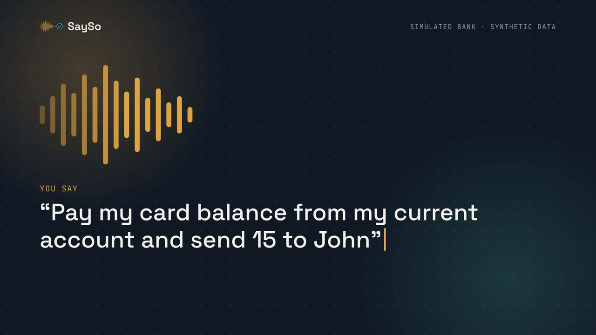 | 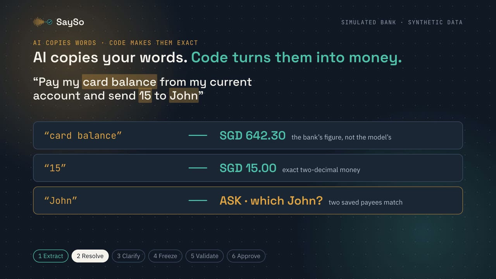 | 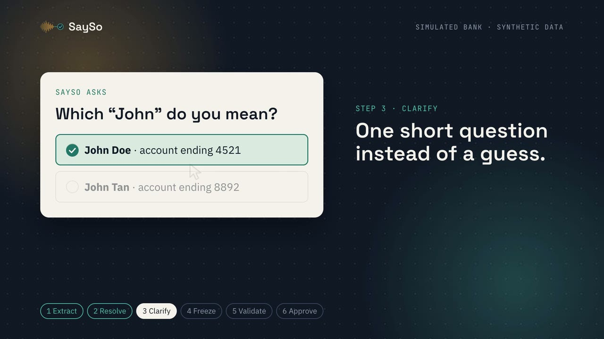 |
| **1. You say it.** Voice or text, in your own words. | **2. AI reads, code decides.** The model only copies words; code turns them into exact amounts, or a question. | **3. One short question.** Code writes the choices from your saved payees. |
| 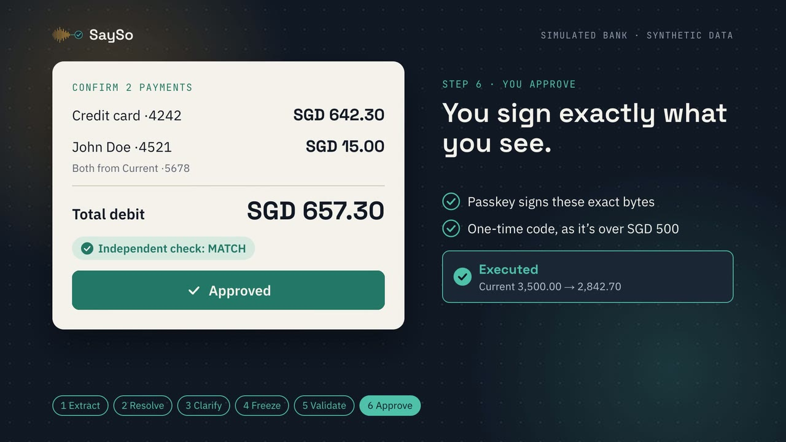 | 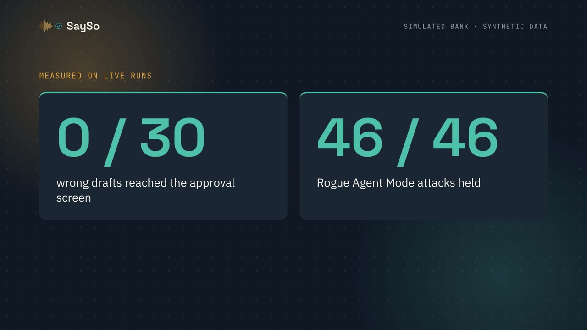 | 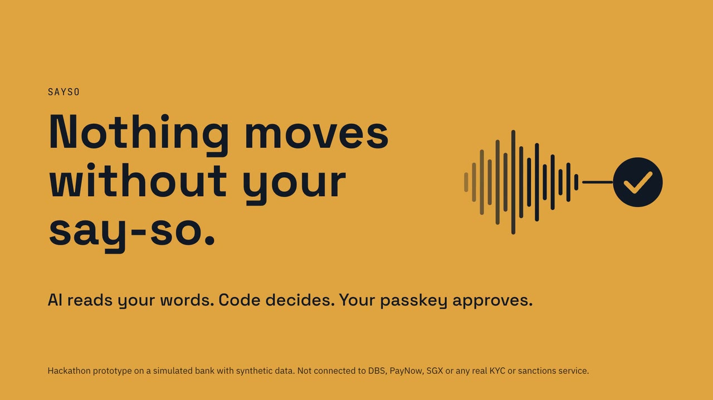 |
| **4. You sign exactly what you see.** Independent check, passkey, one-time code, executed. | **5. Measured.** 0 / 30 wrong drafts reached approval; 46 / 46 attacks held. | **6. Nothing moves without your say-so.** |

The real app (Chrome, Touch ID) and its Langfuse traces for a spoken *"Send John one hundred dollars"* ([full walkthrough](docs/evidence/UI-trace.md)):

| | | |
|:---:|:---:|:---:|
| 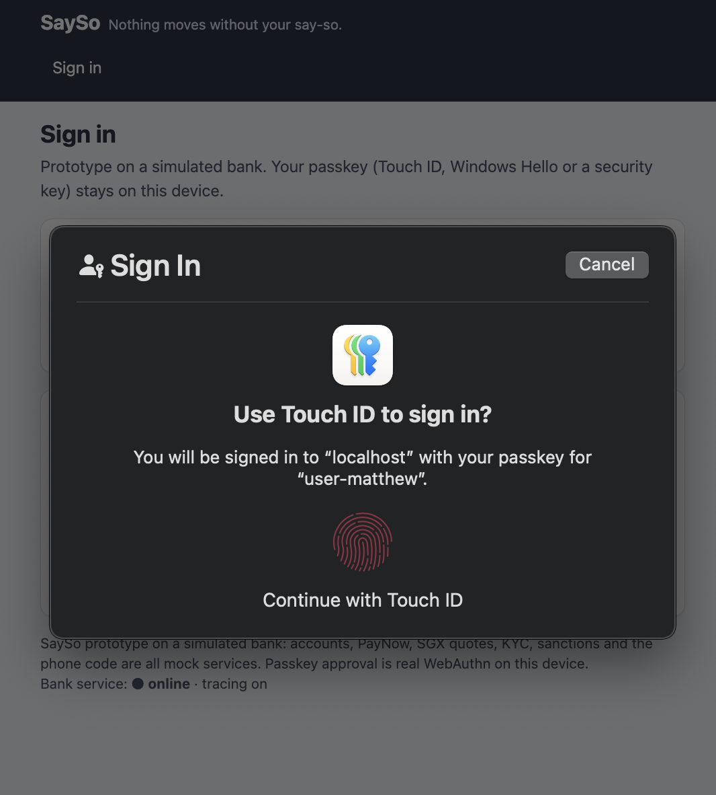 | 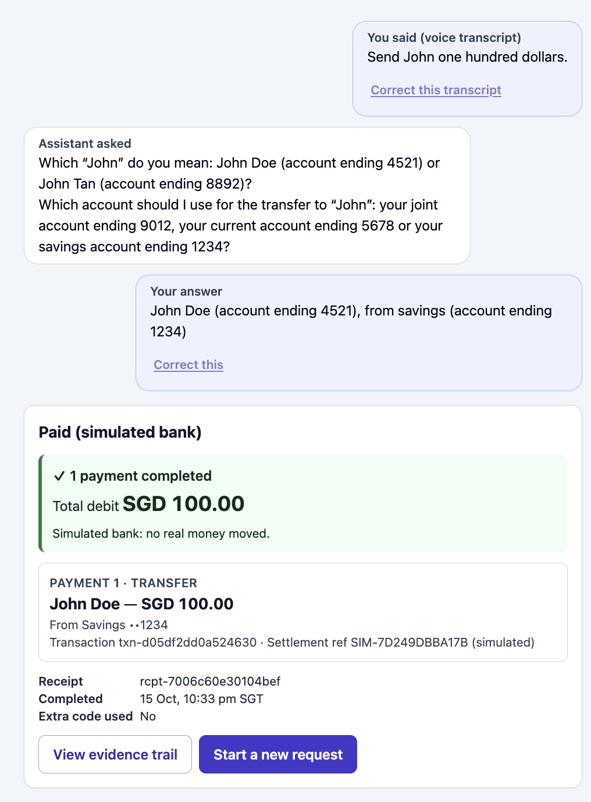 | 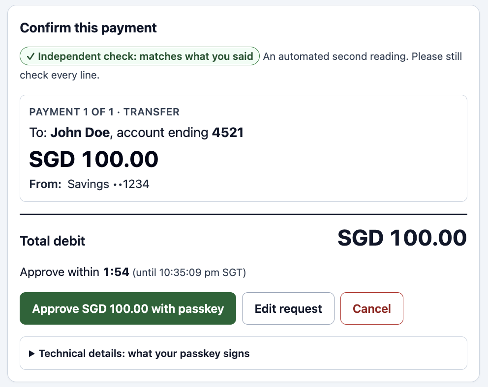 |
| **Sign in.** A real passkey with Touch ID; no password. | **Ask, don't guess.** Code asked which John and which account; the answer is shown in plain words. | **Confirm.** The gateway's frozen payment and the MATCH check, approved within 2 minutes. |
| 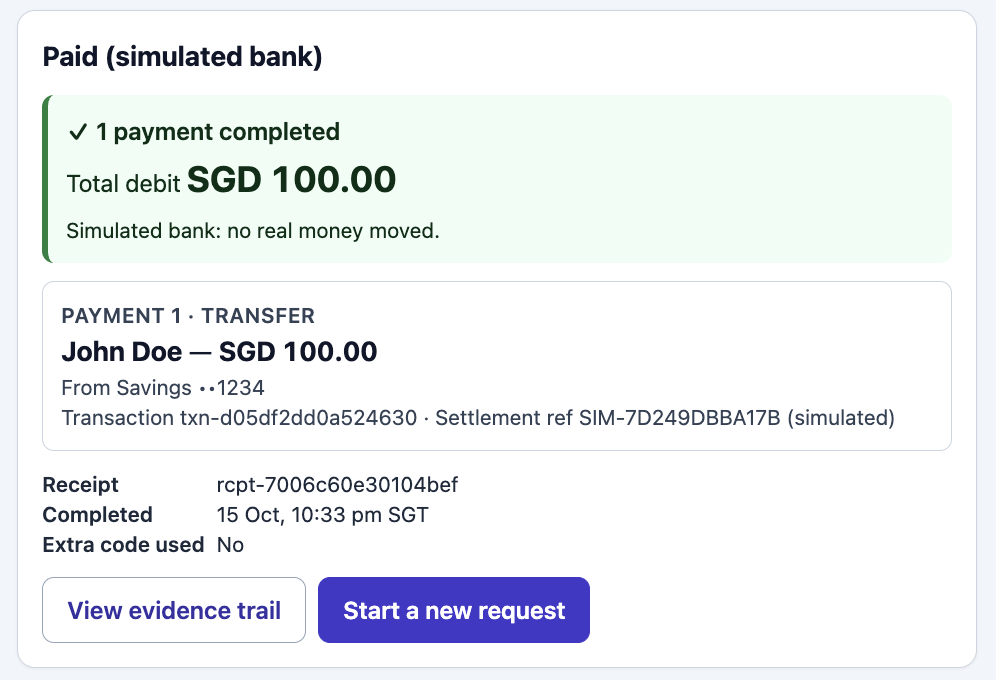 | 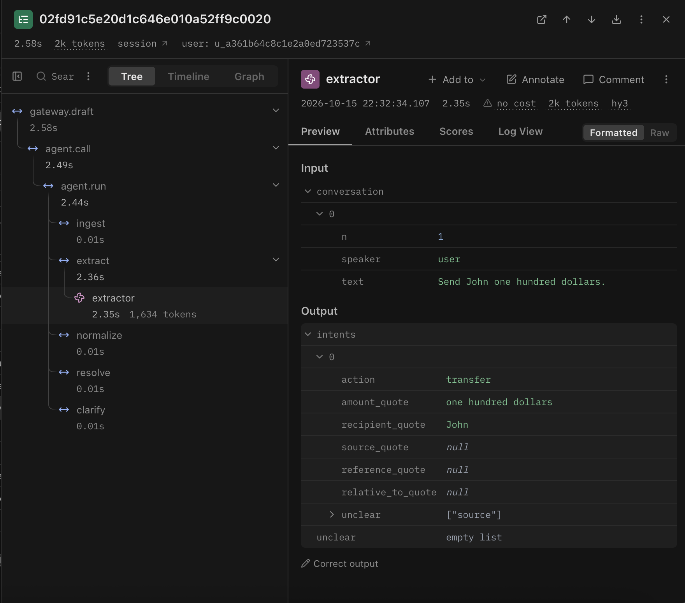 | 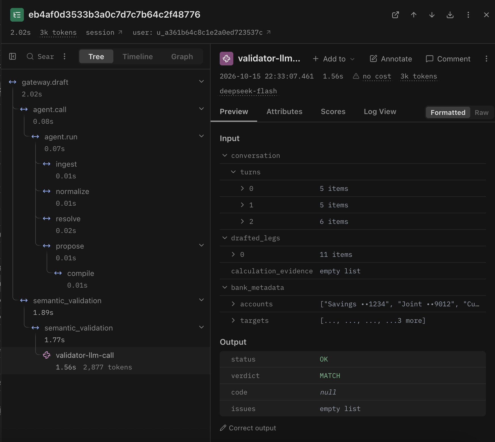 |
| **Receipt.** Executed on the simulated bank, with transaction and receipt IDs. | **Extractor trace.** hy3 returned quotes only ("John", "one hundred dollars", source unclear) in 2.4 s. | **Validator trace.** The tapped answer needed no second extraction; DeepSeek checked the frozen leg: MATCH. |

## Architecture and trust boundary

```
 Browser: chat, mic, passkey ──► GATEWAY: trusted, deterministic. The only service that
                                  │  can open the ledger, sign-off records and audit log.
              scoped 120 s token  │                     stored conversation + frozen bundle
                                  ▼                                   ▼
             AGENT: extractor LLM (TokenHub hy3)    VALIDATOR: second LLM (DeepSeek)
             copies the customer's words; it         reads the conversation and the draft;
             cannot approve or pay                   answers MATCH / MISMATCH / UNCERTAIN
```

There are three services, each with its own container image ([infra/](infra/README.md)): the **gateway** (trusted and deterministic: identity, the conversation record, policy, approval, execution and the audit log), the **agent** (extractor model) and the **validator** (a second model from another vendor). Neither model has tools, ledger access or keys, so even a model that is fooled, or forced to answer MATCH, cannot authorize a payment.

### Security at a glance

Each row is one of the brief's "What the solution should solve" requirements (handbook pp. 6–7).

| Brief requirement | How SaySo meets it | Evidence |
|---|---|---|
| Multi-intent parsing | The extractor only copies the customer's words for each field. Code turns them into amounts, payees and accounts, including "half of that" and "the rest" | 33–34 of 35 live cases correct across three trials, 0 unsafe drafts ([T-14-no-think](docs/evidence/T-14-no-think.md)) |
| Ambiguity resolution | Code (not the model) writes short questions with tappable choices: "Which John?", "Did you mean Ah Ma?" | [E2E-live](docs/evidence/E2E-live.md) |
| Independent validation | The validator compares the whole conversation with the frozen draft. Only MATCH unlocks the confirmation; mismatch, uncertainty or an error stops it | 0 of 30 wrong drafts reached approval ([T-14-no-think](docs/evidence/T-14-no-think.md)) |
| Biometric human-in-the-loop | The confirmation shows the gateway's stored payment. The passkey (Touch ID) signs a SHA-256 hash of exactly those bytes, valid for 2 minutes at most. Any correction voids it | [test_t05_approval.py](tests/test_t05_approval.py) |
| Zero-trust gateway | Only the gateway can touch the ledger. It executes its own stored bytes, never a client payload, after re-checking the signature, owner and every rule in one transaction | Rogue Agent Mode: 46/46 controls held ([T-13](docs/evidence/T-13-attack-matrix.md)); container isolation ([T-04](docs/evidence/T-04-isolation.txt)) |
| Injection shielding | References and quoted text cannot supply an amount, payee or account; embedded instructions make the validator answer MISMATCH; models have no tools | 9/9 adversarial cases safe ([T-14](docs/evidence/T-14-results.md)); [T-09](docs/evidence/T-09-extract.md) |
| Risk and velocity controls | Per-payment and daily limits, velocity, KYC, sanctions and funds checks block outright. Totals above SGD 500 or scam-like wording also need a one-time code from a separate (simulated) channel | Sanctioned and over-limit drafts blocked even after MATCH ([T-14](docs/evidence/T-14-results.md)) |
| Traceable and auditable | Hash-chained audit log, a readable evidence trail per conversation, and Langfuse traces with secrets and account numbers redacted | [T-08](docs/evidence/T-08-telemetry.md); [UI and trace screenshots](docs/evidence/UI-trace.md) |

**Also enforced, not shown to the customer:** single-use approvals (a retry or race returns the original receipt, never a second payment); a 120-second, narrowly scoped token for the agent; validator results bound to the draft, conversation and balances they checked; readiness checks before any model call; and mandate changes signed with the passkey, where loosening a limit waits a cooling period (`#/mandate`).

**Production path, not built:** the bank's own fraud, sanctions and KYC engines; a real out-of-band channel (SMS, hardware token or relationship-manager callback); signed receipts and external audit checkpoints; hosting on HTTPS.

Details: [docs/ARCHITECTURE.md](docs/ARCHITECTURE.md) (diagrams, plus an "As built" section).

## Quick start (local demo)

**You need**
- A device with a platform passkey: a Mac with Touch ID (Chrome or Safari) or a Windows 10/11 PC with Windows Hello (Chrome or Edge); a USB security key also works. Passkeys work on `http://localhost` in a real browser (not an editor's built-in preview); a phone needs an HTTPS origin.
- Python 3.12, [uv](https://docs.astral.sh/uv/), Node.js 20 or newer with npm, and `make`. macOS or Linux for the dev commands. Docker Desktop only for the container stack.
- Four accounts (keys are asked for in step 2; you can skip any and add it later):

| Credential | Where to get it | Used by |
|---|---|---|
| `tokenhub_key` | Tencent Cloud TokenHub, with model `hy3` enabled | Extractor (agent) |
| `deepseek_key` | [DeepSeek platform](https://platform.deepseek.com/) API key | Validator |
| `SDKAppID`, `SDKSecretKey` | A Tencent [TRTC](https://trtc.io/) application. Use the app's **SDKAppID + SDKSecretKey**, not the cloud SecretId/SecretKey | Voice (gateway) |
| `LANGFUSE_PUBLIC_KEY`, `LANGFUSE_SECRET_KEY` | A [Langfuse Cloud](https://cloud.langfuse.com/) project (US region) | Tracing |

**1. Clone and install**

```bash
git clone https://github.com/mattcxj02/Tencent_Cloud_DBS_Hack.git
cd Tencent_Cloud_DBS_Hack
uv sync --extra dev
(cd web && npm install)
```

**2. Create `.env`**

```bash
make env
```

This copies [`.env.example`](.env.example) to `.env` (git-ignored, file mode 600) and:
- **generates the service secrets** with Python's `secrets` module: `VALIDATOR_SERVICE_TOKEN`, `OPERATOR_TOKEN`, `STEP_UP_SECRET` and `GATEWAY_DELEGATION_SECRET` (64 random characters each);
- **asks for the six credentials above**, with hidden input. Press Enter to skip one and fill it in later.

It never prints a value and keeps anything already set, so rerun `make env` at any time to add a skipped key. Prefer no prompts? `python3 scripts/setup_env.py --no-prompt` generates only the secrets; then edit `.env` by hand.

<details>
<summary>What else is in <code>.env</code> (all optional)</summary>

| Purpose | Variables |
|---|---|
| Model choice and timeouts | `EXTRACT_PROVIDER`, `EXTRACT_MODEL`, `EXTRACT_MAX_TOKENS`, `EXTRACT_TIMEOUT_SECONDS`, `EXTRACT_MAX_RETRIES`, `EXTRACT_REASONING_EFFORT`, `VALIDATE_PROVIDER`, `VALIDATE_MODEL`, `VALIDATE_MAX_TOKENS`, `AGENT_TIMEOUT_SECONDS`, `DRAFT_TIMEOUT_SECONDS`, `VALIDATE_TIMEOUT_SECONDS`, `VALIDATOR_CLIENT_TIMEOUT_SECONDS` |
| Voice and tracing endpoints | `TRTC_ASR_HOST`, `LANGFUSE_BASE_URL` |
| Passkeys | `WEBAUTHN_RP_ID=localhost`, `WEBAUTHN_RP_ORIGIN=http://localhost:5173` |
| Prototype limits | `MANDATE_PER_LEG`, `MANDATE_DAILY`, `RISK_THRESHOLD`, `COOLING_HOURS`, `NONCE_TTL_SECONDS` |

The defaults in `.env.example` are the ones used for the demo. Notes:
- `VALIDATOR_SERVICE_TOKEN` is shared by the gateway and validator only, never the agent. Restart both after changing it; restart the agent after changing its model or timeout settings.
- `GET http://localhost:8002/api/ready` checks the validator token and the agent's model configuration without calling any model; `/api/health` reports liveness. A missing or mismatched token fails drafting with a stable 503 before any extractor call.
- If `OPERATOR_TOKEN` or `STEP_UP_SECRET` is missing, the simulated SMS channel is disabled or codes do not survive a restart; low-risk payments still work.
</details>

**3. Run** (two terminals)

```bash
# Terminal 1: fresh synthetic bank, a one-time enrollment code, then the three services
make reset-db
make enroll-code     # prints a code, valid for 15 minutes
make dev             # agent :8001, gateway :8002, validator :8003
```

```bash
# Terminal 2: the web app
cd web && npm run dev
```

Open **http://localhost:5173** (use `localhost`, not `127.0.0.1`: passkeys are bound to it), enter the enrollment code, create a passkey and sign in with Touch ID or Windows Hello.

The demo user starts with savings 12,000.00, current 3,500.00 and joint 2,000.00. The seed also includes saved payees (two Johns, Mum, Ah Ma, Landlord Lim, a PayNow contact and a sanctioned "Northwind Trading"), billers (SP Group, Singtel), a credit card with 642.30 outstanding and mock SGX quotes (D05, O39, U11, Z74).

**Step-up codes.** Payments over SGD 500 or with scam-like wording need a code from the simulated "SMS" channel. In a third terminal (it reads `OPERATOR_TOKEN` from `.env`):

```bash
make operator ARGS='list'                      # payments waiting for a code (never shows codes)
make operator ARGS='code <authorization_id>'   # "delivers" and prints the 6-digit code
```

**Day to day.** Ctrl-C stops all three services; `make stop` does the same from another terminal (a second `make dev` in the same checkout is refused). After pulling changes, run `make upgrade-db` instead of `reset-db` to add new tables and keep your passkey and history. `make reset-db` starts over and removes enrolled passkeys.

**Isolated containers.** `make compose-up` starts the three services in separate containers, with separate users and networks, and only the gateway holds the database volume. `make compose-down` stops them. `make isolation-probe` builds the stack, runs the in-container probes, checks that no image contains `.env`, then tears everything down. The recorded demo uses `make dev`. The browser demo has not yet been rehearsed against the container stack: it would need seeding and an enrollment code inside the gateway container.

**Things to try**: these phrasings were measured in [docs/evidence/E2E-live.md](docs/evidence/E2E-live.md) and [docs/evidence/T-14-results.md](docs/evidence/T-14-results.md):
- "Send fifty bucks to Mum from my savings and twenty dollars to Ah Ma from savings"
- "Send 20 to mom from savings" or "... to ahma ..." (bank aliases and spacing variants resolve directly), "Send 20 to Ahmar from savings" (a near spelling: the assistant asks "Did you mean: Ah Ma (account ending 7766) or none of these?" and can remember "Ahmar" as your nickname). Nicknames are managed on the **Payees** page.
- "Pay my card balance from my current account and send 15 to John" (then answer "John Doe" and "my current account"; the SGD 657.30 total needs a step-up code)
- "Move $1,000 from current to savings and then buy DBS shares with half of that from savings"
- "Send $150 to Northwind Trading from my current account" (blocked: simulated sanctions)

## Tests, evaluations and probes

```bash
make test            # pytest suite (each test uses its own temporary database)
make lint            # ruff
make web-build       # TypeScript strict check and production build
make eval-fake       # evaluation harness dry run with fake models (no network)
make eval            # live 35-case golden set + Langfuse experiments (about 10 minutes, uses model credits)
make isolation-probe # container isolation proof (Docker)
make smoke-llm smoke-asr smoke-langfuse smoke-voice smoke-extract smoke-validate smoke-telemetry   # live checks
```

Rogue Agent Mode (local only): `uv run python scripts/rogue_agent_demo.py` runs 46 attacks against the real gateway with a malicious extractor and a validator forced to answer MATCH: all 46 controls held; the ledger was unchanged in 42 rows and the 4 retry/race rows produced exactly one legitimate commit. See [docs/evidence/T-13-attack-matrix.md](docs/evidence/T-13-attack-matrix.md).

## Documentation

| Document | What it covers |
|---|---|
| [docs/ARCHITECTURE.md](docs/ARCHITECTURE.md) | Trust zones, approval lifecycle, sequence diagram, as-built differences |
| [docs/evidence/](docs/evidence/README.md) | Outputs from real runs: smokes, isolation probes, telemetry, extraction, voice, end-to-end, evaluation, CodeBuddy sessions |
| [docs/launch/](docs/launch/README.md) | 24-second launch video, poster, scene stills, 16:9 covers, storyboard and the Hyperframes source |
| [docs/cover/](docs/cover/README.md) | Original 16:9 cover image (SVG) and export steps |
| [CODEBUDDY.md](CODEBUDDY.md) | Project rules and invariants given to the coding agents |
| Folder READMEs | [gateway](gateway/README.md), [agent](agent/README.md), [validator](validator/README.md), [shared](shared/README.md), [ledger](ledger/README.md), [prompts](prompts/README.md), [web](web/README.md), [infra](infra/README.md), [evals](evals/README.md), [scripts](scripts/README.md), [tests](tests/README.md) |

## Status (15 Oct 2026)

Built: all four payment actions, bundles of 1–4 legs, clarifications (with clickable choices) and corrections, the independent validator, exact-payload passkey approval, hard policy, step-up, mandates, atomic execution, audit, Langfuse, voice through TRTC, live progress stages, the React UI and container isolation. The server side is covered by 1,380 pytest tests and by the live runs in [docs/evidence/](docs/evidence/README.md); extraction takes about 2 s at the median ([T-14-no-think](docs/evidence/T-14-no-think.md)). The React UI is type-checked and builds, with browser fixture pages in `web/tests/`. **Still pending:**
- the multi-payment and step-up flows in a real browser (they ran live with a software passkey over the real HTTP API; one spoken payment has been run in Chrome with Touch ID: [UI-trace](docs/evidence/UI-trace.md));
- the 5–8 minute demo video (a 24-second [launch video](docs/launch/README.md) is done) and any hosted deployment.

## Limitations

- **Attack testing is finite.** 46 attacks held ([T-13](docs/evidence/T-13-attack-matrix.md)), but a valid citation does not prove meaning: "Mum lent me 500" can be drafted as 500, which the customer then sees and must reject. A reference the agent does not declare is not checked against the amount (the passkey and step-up still apply).
- **Small evaluation.** 35 typed English cases, one to three trials per configuration, hand-made wrong drafts, measured on extractor prompt v2 (the current v3 adds one rule and has not been re-run). One held-out case (`adv-07`) informed a v2 rule. These numbers are not a security proof.
- **Latency.** With reasoning off, extraction is about 2 s at the median (p95 about 3 s); with reasoning on (the default when `EXTRACT_REASONING_EFFORT` is unset) it was 9–11 s and up to 31 s. Voice-to-ready time has not been measured separately.
- **Validator limits.** It occasionally runs out of output tokens on 4-leg drafts; this blocks the draft (fails closed).
- **The confirmation is application UI,** not a browser-protected payment display, and passkey user verification may be a PIN.
- **The audit chain is tamper-evident only** relative to retained history: no external checkpoints, and no protection against a privileged full rewrite.
- **Scam rules are keyword heuristics,** with false positives and false negatives.
- **Isolation.** Containers share one Docker host and kernel; `make dev` runs without isolation.
- **Not measured:** time saved versus a standard app flow (no usability sessions were run), voice accuracy with real Singaporean speakers, and model cost.
- Pausing the mandate stops this assistant only, not cards or other channels. A phone needs an HTTPS origin and re-enrollment. The Langfuse project is private; the [UI-trace](docs/evidence/UI-trace.md) screenshots show its traces.

## How it was built

CodeBuddy Code CLI built tasks T-00 to T-04 and most of T-05 in headless sessions (logs summarized in [docs/evidence/codebuddy/](docs/evidence/codebuddy/README.md)) until its credits ran out on 10 Oct ([screenshots](docs/evidence/codebuddy/README.md#screenshots)). Claude Code subagents built the remaining tasks. A lead Claude Code session reviewed every task: it read the diffs, re-ran the checks and fixed the defects it found.

## Credits

**Building SaySo**

| Tool or service | Used for |
|---|---|
| [CodeBuddy Code](https://www.codebuddy.ai/) | Built tasks T-00 to T-04 and most of T-05 ([session logs](docs/evidence/codebuddy/README.md)) |
| [Claude Code](https://claude.com/claude-code) | Built the remaining tasks and reviewed every task |
| Tencent Cloud [TokenHub](https://www.tencentcloud.com/) (`hy3`) | Extractor model |
| [DeepSeek](https://www.deepseek.com/) | Independent validator model |
| [Tencent TRTC](https://trtc.io/) | Speech recognition for voice requests |
| [Langfuse](https://langfuse.com/) | Tracing and evaluation experiments |

**Launch video and images** ([details and licences](docs/launch/README.md#credits))

| Tool or asset | Used for | Licence |
|---|---|---|
| [brag](https://github.com/latent-spaces/brag) by latent-spaces | Launch-video workflow: storyboard, brief, poster, share copy | MIT |
| [Hyperframes](https://github.com/heygen-com/hyperframes) by HeyGen | Composition checks and rendering | Apache-2.0 |
| [GSAP](https://gsap.com) | Animation | GSAP Standard License |
| "Happy Beats / Business Moves" vol. 11 by [ende.app](https://ende.app/en) | Music | Bundled with brag |
| [Kenney](https://kenney.nl/) and unicae_games sound packs | Sound effects | CC0 |
| Space Grotesk, IBM Plex Sans, JetBrains Mono | Type | SIL OFL 1.1 |
| Claude Code | Followed the brag workflow, wrote and rendered the composition | — |
