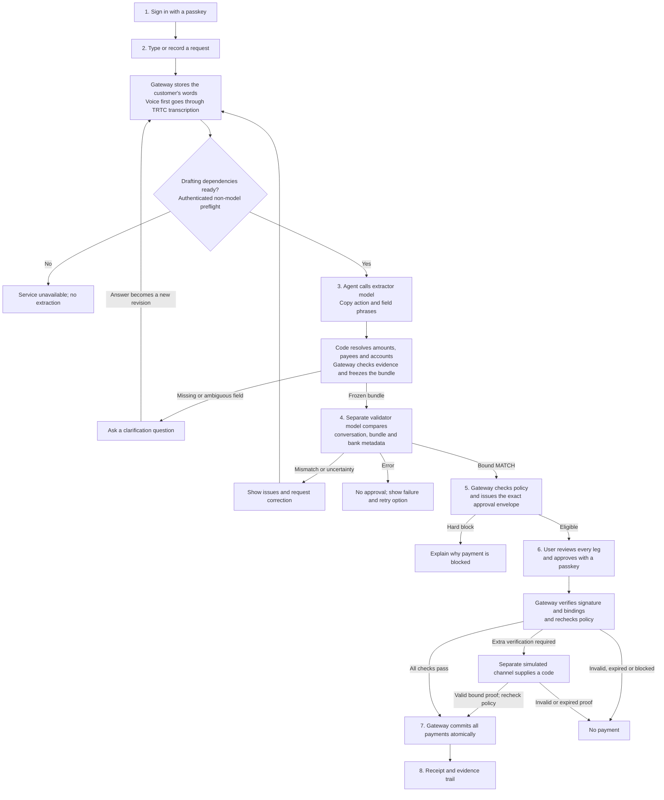
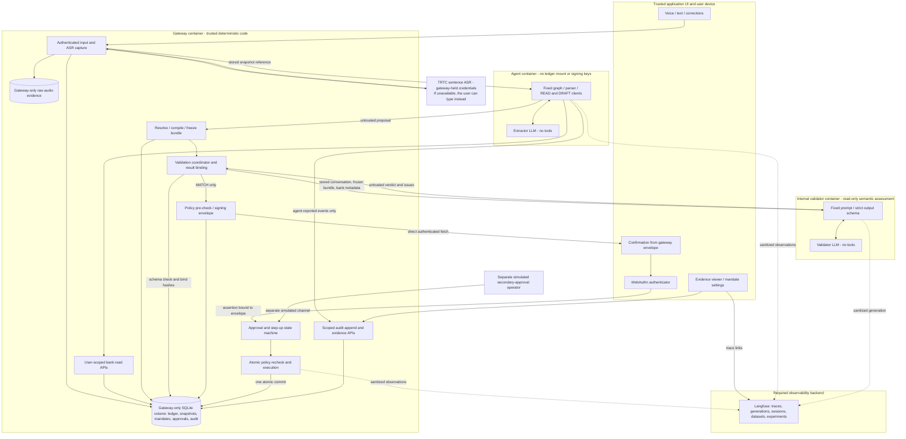
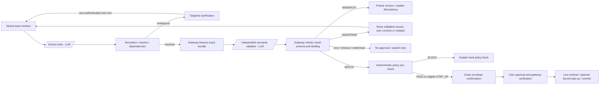
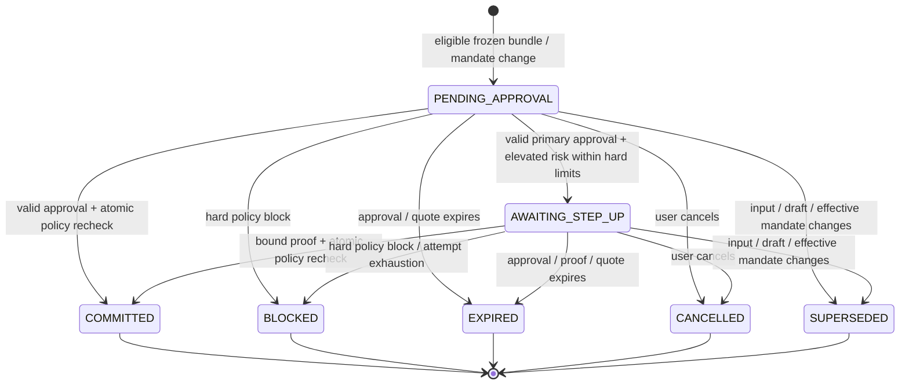
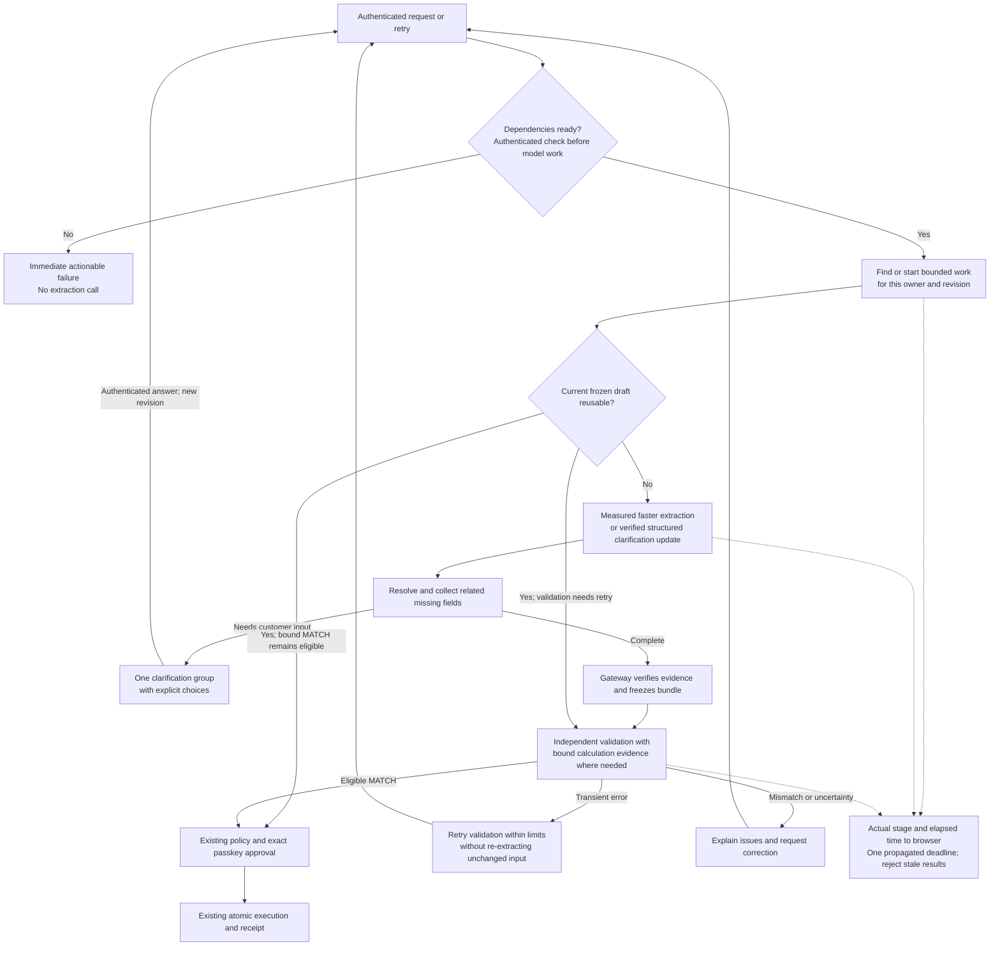

# DCTA v0.3 architecture

Current implementation overview, reviewed **13 October 2026** against the working tree (all six improvement-plan phases merged). These diagrams describe the code, not a claim that every dependency is configured or that the system is deployed. The final section separates verified readiness from the remaining proposed improvements. See [PLAN.md](PLAN.md) for the original contracts and [IMPROVEMENT_PLAN.md](IMPROVEMENT_PLAN.md) for the consolidated improvement plan and implementation brief.

DCTA turns a customer's words into a bundle of 1–4 simulated SGD transactions: transfers to own accounts, saved payees or PayNow contacts; bills; card payments; and mock SGX purchases. **Models prepare and check drafts. Only the gateway can execute, after the user approves the exact stored payment.** Bank data and settlement are synthetic; passkey approval uses real WebAuthn. Langfuse is the required observability backend.

## The whole journey at a glance

Read this diagram first; the sequences below expand each stage. A *revision* is a version of the conversation, a *bundle* is the exact ordered set of payments, and an *envelope* binds that bundle to its owner, credential, policy version and approval expiry.



No funds move during capture, drafting, validation or envelope creation. Each model call is awaited before the next dependent stage. A clarification starts another extraction run; the validator runs only after a draft has been frozen.

## Who owns each piece of information

| Information | Authoritative owner | Where it flows |
|---|---|---|
| Typed words, answers and corrections | Gateway conversation store, captured from an authenticated user | Current turns to extractor; bound history to validator; transcript to browser |
| Recorded WAV and transcript | Gateway audio evidence and conversation store | Exact stored audio to TRTC; transcript back to browser and model workflow; raw audio excluded from Langfuse |
| Payee names, aliases, customer nicknames, accounts and quotes | Gateway bank records | Scoped reads to agent; relevant labels and terms to validator; resolved details to confirmation |
| Extracted phrases and candidate legs | Untrusted agent output | Gateway verifies quoted evidence, ownership and deterministic amount calculations |
| Frozen bundle and semantic result | Gateway stores immutable bundle and bound validation record | Validator checks the bundle; only an eligible MATCH permits envelope issuance |
| Approval envelope, nonce and expiry | Gateway | Browser renders its contents; authenticator signs its derived challenge |
| Signature and optional code proof | Verified by gateway against the stored authorization | Never accepted as authority for a different owner, operation or payload |
| Financial effects, audit and receipt | Gateway-only SQLite database | Commit together; browser retrieves receipt and evidence |
| Redacted traces and model usage | Langfuse, for observation only | Correlated across services; never grants approval or triggers settlement |

## Trust zones and data ownership

**Trust zones and data ownership**



The gateway alone owns ledger files and authoritative conversation/approval records. The agent cannot invent user turns, accept its own validation result, or write trusted gateway audit events. Internal calls use scoped service credentials and session/user binding. Validator responses are schema-checked evidence, not permission to execute. Neither LLM has payment tools. Container identities, mount permissions and API authorization establish the boundary; AST import tests alone do not.

All bank, KYC, sanctions, PayNow, equity and secondary-approval behavior is simulated. WebAuthn is implemented; it is not an LLM judgement or a simulated biometric. Application UI, gateway deployment, identity store and authenticator are trusted assumptions. A prompt-injected model is in scope; a compromised gateway host/browser is not covered by the demonstrated guarantee. Container isolation applies to the Compose deployment; local `make dev` processes do not establish those container boundaries.

## Input capture: text, voice and corrections

```mermaid
sequenceDiagram
  autonumber
  actor U as Customer
  participant B as Browser
  participant G as Gateway
  participant D as Gateway storage
  participant S as TRTC ASR
  Note over B,G: Authenticated session and owned conversation required
  alt Typed request or clarification answer
    U->>B: Type request or answer
    B->>G: POST conversation text or answer
    G->>D: Store user turn and advance revision
    G-->>B: Stored turn
  else Voice request
    U->>B: Consent, record, then stop
    B->>G: POST conversation voice, 16 kHz mono WAV
    G->>D: Store audio; read back and verify digest
    G->>S: Exact WAV plus scoped hotwords
    S-->>G: Transcript and ASR metadata
    G->>D: Store linked ASR turn and advance revision
    G-->>B: Transcript, audio reference and turn
  end
  B->>G: GET conversation
  G-->>B: Stored transcript
  B->>G: POST conversation draft
  Note over B,G: Current UI starts drafting automatically after capture
  opt Customer subsequently edits the transcript
    U->>B: Correct the stored words
    B->>G: POST transcript-edit with original turn reference
    G->>D: Store new revision; supersede pending work
    B->>G: POST conversation draft again
  end
```

Voice is push-to-talk sentence transcription, not streaming. The browser never submits its own text as a trusted ASR result. The transcript is displayed before approval, but the current UI immediately starts drafting and disables editing while busy; it does not pause for a separate transcript-acceptance step. ASR errors prevent drafting from that failed transcription.

## Drafting: where the model calls happen

```mermaid
sequenceDiagram
  autonumber
  participant B as Browser
  participant G as Gateway coordinator
  participant A as Agent
  participant E as Extractor model
  participant D as Gateway database
  participant V as Validator service
  participant M as Validator model
  B->>G: POST /api/conversations/{id}/draft
  G->>G: Require configured validator service token
  G->>V: GET /internal/ready with shared token (no model)
  V-->>G: Authenticated and model configured, or failure
  G->>A: GET /ready (no model)
  A-->>G: Model configured, or failure
  Note over B,V: Any failed preflight returns 503 before extraction; total cap 3 s
  G->>A: POST /internal/run with scoped delegation token
  A->>G: Read owned conversation snapshot
  G-->>A: Current revision and turns
  A->>E: Fixed prompt plus conversation words
  E-->>A: JSON actions and quoted field phrases
  A->>A: Locate evidence and normalize amounts
  A->>G: Scoped bank reads for accounts and recipients
  G-->>A: Records, aliases, nicknames and requested terms
  A->>A: Resolve exact records and dependencies
  alt Missing or ambiguous information
    A->>G: Record a code-generated clarification question
    G->>D: Store app question
    A-->>G: Clarification result
    G-->>B: Question to show the customer
    Note over B,E: Customer answer creates a new revision and repeats extraction
  else All required fields resolved
    A->>G: POST /internal/drafts with untrusted proposal
    G->>G: Verify evidence, ownership and amount derivation
    G->>D: Freeze canonical bundle and conversation binding
    G-->>A: Frozen bundle reference
    A-->>G: Agent run complete
    G->>V: Stored conversation, bundle and bank metadata; service token
    V->>M: Independent prompt; no extractor reasoning
    M-->>V: Structured MATCH, MISMATCH or UNCERTAIN
    V-->>G: Checked result, or explicit error
    G->>D: Store result bound to input and bundle hashes
    G-->>B: Ready, needs correction, or failure
  end
  Note over G,M: Missing credentials, timeouts and malformed output never permit approval
```

Extraction and semantic validation are sequential because the validator needs the frozen draft. Ordinary resolution is code, not another reasoning agent. Intermediate agent audit reports also travel through gateway HTTP endpoints. See [agent/workflow.py](../agent/workflow.py), [gateway/orchestration.py](../gateway/orchestration.py) and [gateway/validation.py](../gateway/validation.py).

## Conversation and validation decisions



The validator reads full original turns, clarification questions, corrections and minimum bank metadata. It does not read extractor reasoning. It runs after a draft exists; “independent” does not mean both stages execute simultaneously. A MATCH only permits confirmation. An incorrect transcript may fool both models; display and correction remain necessary.

Every correction creates a revision and supersedes all associated pending validation/approval records. A changed quote or bundle creates a new draft and requires revalidation and reapproval. Metadata fields and provenance tags are not instructions, even when they came from a bank record. Inference remains probabilistic; policy and execution operate deterministically on fixed inputs/state.

## Approval lifecycle



For a payment, transition to COMMITTED and all financial effects, nonce/proof consumption, counters, audit and receipt share one SQLite transaction. For a signed mandate change, COMMITTED means the requested policy update is recorded; an increase remains pending until its cooling time. Authenticated retries of an already committed identical operation return its receipt, not new execution. Invalid signatures leave no financial effects and are rate-limited/audited; they do not let an unrelated caller cancel another user's approval.

Hard-limit breaches are always BLOCK. Secondary approval cannot override mandate, KYC, ownership, sanctions, funds or velocity. During cooling the old mandate stays active; decreases/pauses cancel pending increases and invalidate pending payments. Any effective mandate-version change requires reapproval.

## Exact approval, execution and receipt sequence

```mermaid
sequenceDiagram
  autonumber
  actor U as User
  participant UI as Client
  participant G as Gateway
  participant D as Gateway-owned database
  participant P as Passkey authenticator
  participant O as Separate demo operator channel

  Note over UI,G: Start with a frozen draft and eligible, bound MATCH
  UI->>G: Request approval envelope
  G->>G: Ownership and policy pre-check
  G->>D: Store canonical envelope, nonce, expiry, hash
  G-->>UI: Exact envelope and WebAuthn challenge
  UI->>U: All legs, accounts, totals and quote terms
  U->>UI: Choose Approve
  UI->>P: WebAuthn request with envelope-derived challenge
  P->>U: Ask for user verification
  U->>P: Touch ID, PIN or supported verification
  P-->>UI: Signed assertion
  UI->>G: Authorization ID, expected hash, assertion
  G->>G: Verify identity, signature, freshness and bindings
  alt Elevated risk inside all hard limits
    G->>D: Persist AWAITING_STEP_UP, no financial effects
    G-->>UI: Simulated secondary approval required
    O->>G: Authenticated operator request for demo code
    G-->>O: Authorization-bound code
    O-->>U: Simulated out-of-band delivery
    U->>UI: Enter the code
    UI->>G: Authorization-bound secondary proof
  end
  G->>D: Begin write transaction and recheck state/policy
  G->>D: Apply all legs, consume approval, audit, receipt; commit
  G-->>UI: Persisted receipt
  UI->>G: GET conversation evidence
  G->>D: Read owned evidence and audit records
  G-->>UI: You said, clarified, approved and executed; trace links
  Note over G,D: Reject atomically if any check fails; no partial payment
  Note over UI,D: Same committed authorization retry returns the stored receipt
```

Signing formula: `SHA256(b"DCTA:approval:v1\x00" + canonical_bytes(SigningEnvelope))`. The envelope includes user, credential, operation, immutable full payload, conversation binding where applicable, active mandate version, nonce and expiry. One implementation issues and verifies it. The gateway executes stored bytes and ignores/rejects any attempt to replace the payload. WebAuthn user verification can use a PIN; ordinary WebAuthn does not make the React confirmation a browser-trusted payment display.

## Observability and evidence

Langfuse is a real required backend: correlated traces across agent/validator/gateway, separate extraction/validation generations, prompt hashes, latency, available tokens/cost, sessions and dataset experiments. End observations before human waiting and link resumed turns by session/revision. Explicit allowlists exclude secrets, raw audio, assertions and unmasked account data. Trace IDs never grant access or establish authorization.

The gateway's prototype hash chain stores authoritative decisions and distinguishes untrusted agent event reports. Local audit failure rolls back payment. Langfuse outage reports degraded observability and triggers bounded sanitized export retry, but cannot relax controls or repeat a payment. The final submission must still include verified backend traces and experiment runs. A hash chain alone cannot prove resistance to privileged full rewriting or tail deletion; signed external checkpoints remain future work.

The MVP diagram intentionally shows no signed pack registry, agent-signed draft, gateway-signed ledger order or signed receipt. Those were unimplemented additions to the prior drawing; the full product features in PLAN remain unchanged. Recommendations are preserved in `PLAN_REVIEW.md` as optional future work.

## Implementation details and current limitations (12 Oct 2026)

Details behind the current-flow diagrams. Historical measurements below retain their original dates; they are not fresh performance guarantees. Sources: the implementation, folder READMEs and [evidence/](evidence/README.md).

- **Evidence-based lineage instead of model span references.**
  - The extractor returns quoted words only: no IDs, offsets or display names. The agent finds each quote verbatim in a current user turn and narrows it to words that name exactly one bank record.
  - The gateway (`gateway/evidence.py`) re-checks all three conditions: the location; that the words name exactly one record; and that cited amount words mean exactly the proposed amount (`shared/amounts.py`).
  - References and double-quoted text cannot supply critical fields. An ambiguous name ("John") is refused until the user disambiguates. The source account must also come from the user's words, so "send 15 to John" without a source gets a question ([E2E](evidence/E2E-live.md)).
- **Clarification questions are written by code** (`agent/questions.py`) from fixed text, the user's own words and gateway bank labels. They are never model text.
- **Orchestration route.**
  1. The browser calls `POST /api/conversations/{id}/draft`.
  2. Before model work, the gateway checks token presence, authenticated validator readiness and agent configuration with bounded non-model checks. Failed checks return a stable 503 code without extraction. It then mints a 120 s delegation token for that user and conversation, with exactly the scopes `conversation:read`, `bank:read`, `draft:freeze`, `conversation:propose_question` and `audit:append_agent`.
  3. It calls the agent's `/internal/run` with a `traceparent`. The proposal comes back through `/internal/drafts`, where the gateway freezes it.
  4. The gateway then runs the validation coordinator in-process, which calls the validator service over HTTP. One overall deadline (`DRAFT_TIMEOUT_SECONDS`, default 90 s) is propagated to the agent and provider in the `X-DCTA-Deadline` header; no stage starts after it expires. Drafting is single-flight per owner and conversation revision. If the conversation changes mid-run, the request ends with `CONVERSATION_CHANGED`/`STALE_CONVERSATION_REVISION` and no late result is published; the browser then starts one new draft at the latest revision.
  5. The browser polls `GET /api/conversations/{id}/progress` (owner, operation and revision scoped; about once a second, bounded) and shows the stage the backend has actually reached: transcribing, extracting, resolving, validating, ready, needs input or failed.
- **Timeouts and token budgets.** Each stage receives only the remaining part of the overall drafting deadline; the per-stage limits below are upper bounds:

  | Setting | Value | Why |
  |---|---|---|
  | Overall drafting (`DRAFT_TIMEOUT_SECONDS`) | 90 s | Admission, readiness, extraction and validation share one deadline |
  | Gateway → agent (`AGENT_TIMEOUT_SECONDS`) | 45 s | Raised from 15 s after a live `hy3` turn took 17.4 s; 5 of the 35 T-14 runs exceeded 15 s, and the maximum was 29.0 s |
  | Validator model deadline (`VALIDATE_TIMEOUT_SECONDS`) | 30 s | |
  | Gateway's validator client | 40 s | |
  | Extractor client (`EXTRACT_TIMEOUT_SECONDS`, `EXTRACT_MAX_RETRIES`) | 40 s per request, zero SDK retries | Fits inside the 45 s gateway wait (reasoning-on requests measured up to 31 s); capped further by the remaining shared deadline when delegated |
  | `EXTRACT_MAX_TOKENS`, `VALIDATE_MAX_TOKENS` | 4096 each | `hy3` reasons before answering; the validator budget was raised from 2048 after two empty outputs in T-14 |
  | `EXTRACT_REASONING_EFFORT` | unset (old behaviour); measured configuration `no_think` | `no_think` with extractor prompt v2: median 1.85 s, p95 2.79 s, 34/35, 0 unsafe drafts ([T-14-no-think](evidence/T-14-no-think.md)) |

  A validation error allows at most 3 attempts per draft and never becomes MATCH.
- **Validator input.**
  - The request is built by the gateway alone: the stored bundle bytes, the turns covered by the stored conversation hash, bank labels for every leg target plus **every other saved payee of the same kind** (so "Ah Ma" cannot be mistaken for Mum's alias "Mama"), and same-name billers and cards.
  - Derived amounts ("the rest", "half of that") carry gateway-frozen **calculation evidence**: the balance snapshot, ordered preceding debits, dependencies and result, as exact money (`gateway/calculations.py`). A wrong derived amount is refused deterministically (`INVALID_REQUEST`) before the model is called.
  - Validator prompt v2 judges agreement with the customer's request, not risk: risky but faithful requests can MATCH because the gateway's sanctions, scam step-up, mandate and funds rules still apply. Embedded instructions that change a field or add a leg remain MISMATCH.
  - A result is bound to the bundle, conversation, bank-label, calculation-evidence and input hashes. A changed bank label or relevant balance makes a MATCH ineligible. A transient validation error can be retried against the same frozen draft while every binding is unchanged.
- **Voice.**
  - Push-to-talk sentence ASR, not streaming. The browser uploads a 16 kHz mono WAV, and the gateway stores and digest-checks it before transcription.
  - No route accepts client-supplied ASR text.
  - The user's own saved payee names, bank aliases, customer nicknames and billers are passed to TRTC as `hotword_list` (sanitized, at most 30 words). Without them "Ah Ma" was heard as "Amma" ([T-12](evidence/T-12-voice.md)).
- **Payee matching.** Shared name rules ignore case and word spacing. Near spellings are suggestions only; the customer must resolve the recipient exactly. Nicknames are managed through authenticated gateway routes and included in bank reads, validator labels and voice hotwords. They do not authorize a payment.
- **Step-up channel.** It is simulated by the gateway operator routes plus `scripts/operator_console.py`. These are enabled only when `OPERATOR_TOKEN` (at least 32 characters) is set, and they refuse user sessions and agent tokens. The step-up challenge expires with the signed envelope (120 s or less).
- **Approval UI.** Approval happens in the chat's confirmation, and there is no separate Approve page. It signs the WebAuthn options derived from the stored envelope. Passkeys must be discoverable (resident) credentials.
- **Langfuse.**
  - Langfuse Cloud (US region), SDK 4.17. Read-back uses the v2 observations API, because the legacy trace API returns 410 for this organization.
  - The gateway's `ingest` span never exports turn text. Model generations export the model-visible data, with account IDs replaced by display labels.
- **Isolation.** Compose uses two bridge networks, `agent_net` and `validator_net`. Neither is `internal`, so both models keep outbound LLM egress, but the agent and validator cannot reach each other. Their root filesystems are read-only, only the gateway has the `/data` volume, and each container gets only its own LLM key ([T-04](evidence/T-04-isolation.txt)).
- **Usability baseline.** A conventional form at `#/baseline` (it makes no gateway calls), for the comparison study in `evals/usability/`.
- **Attack checks.** The Rogue Agent Mode harness rerun on 12 Oct held 46/46 controls with synthetic data; the historical [T-13 attack matrix](evidence/T-13-attack-matrix.md) was preserved. Its container row still uses retained evidence, not a fresh container probe.
- **Not built:** signed pack registries, signed receipts, external audit checkpoints, Tencent APM, TTS and public hosting.

## Why processing feels slow

| Evidence | Observation | Implication |
|---|---|---|
| Local audit database, 11–12 Oct; read-only review, 7 extraction calls | Median 13.6 s; range 7.3–24.2 s | Extraction is already a long wait before any successful validation |
| [10 Oct golden evaluation](evidence/T-14-results.md), 35 agent runs | Extractor median 8.943 s; entire agent median 8.972 s | Model latency dominated that measured run; these are separate medians, not per-request subtraction |
| Same evaluation, 25 natural drafts | Validator median 1.333 s, p95 5.567 s | Independent validation adds a sequential model call |
| [Recorded end-to-end flow](evidence/E2E-live.md), two clarification answers | 17.9 + 9.5 + 11.7 = 39.1 s of processing | Repeated extraction compounds the wait, excluding human response time |
| Local validation records, 12 Oct | Both attempts failed with `SERVICE_TOKEN_UNSET` | Extraction completed before a configuration failure; retrying cannot repair the missing token |
| [Integrated run, 12 Oct](evidence/T-14-no-think.md), `no_think` + extractor-v2 | Extractor median 1.85 s, p95 2.79 s (was 10.6 s / 27.4 s in the same-day baseline) | Model reasoning was the dominant cost; one trial, not a confidence interval |

The local settings loaded during the review also reported an unconfigured validator service token. This is a dated observation, not a live service-health assertion. The gateway now separates liveness (`/health`, `/api/health`) from drafting readiness (`/ready`, `/api/ready`). The latter authenticates to the validator and checks agent model configuration without provider calls. Secret presence alone does not establish provider access; live smoke checks remain necessary. The frontend now shows the backend's actual drafting stage and elapsed time. The extractor's reasoning is configurable with `EXTRACT_REASONING_EFFORT`.

## Improvement flow — implemented

All nodes below are implemented and regression-tested (13 Oct 2026); browser behaviour is covered by fixture tests, not yet by a real-browser walkthrough. Detailed work and acceptance criteria are in [IMPROVEMENT_PLAN.md](IMPROVEMENT_PLAN.md). Each reusable result must remain scoped to its owner and bound to the current conversation, bundle and relevant bank state. A model setting change must first pass accuracy evaluation.



Readiness checks, configurable extractor reasoning and timeouts, structured clarification choices, calculation evidence, one propagated deadline with single-flight drafting and safe reuse, and actual-stage progress are implemented and covered by regression tests. The progress registry and single-flight lock are in-process: the gateway is designed to run as one process. Independent validation, exact-payload approval, policy enforcement and atomic execution remain required throughout.
