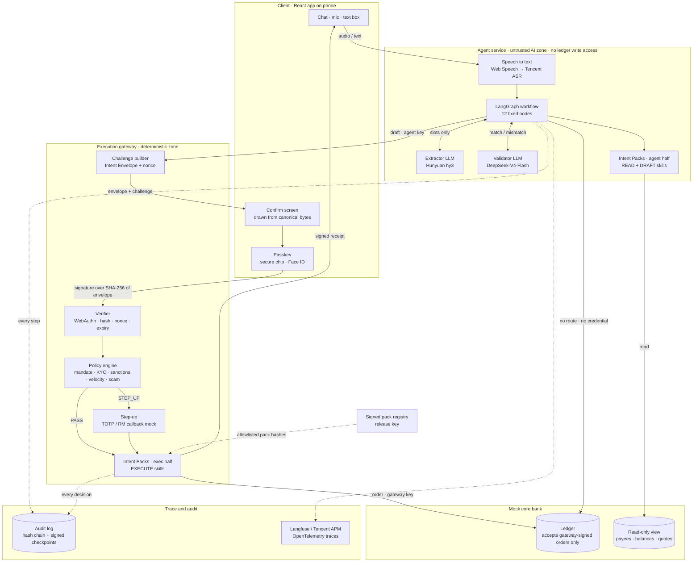
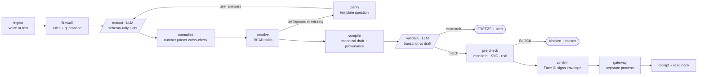
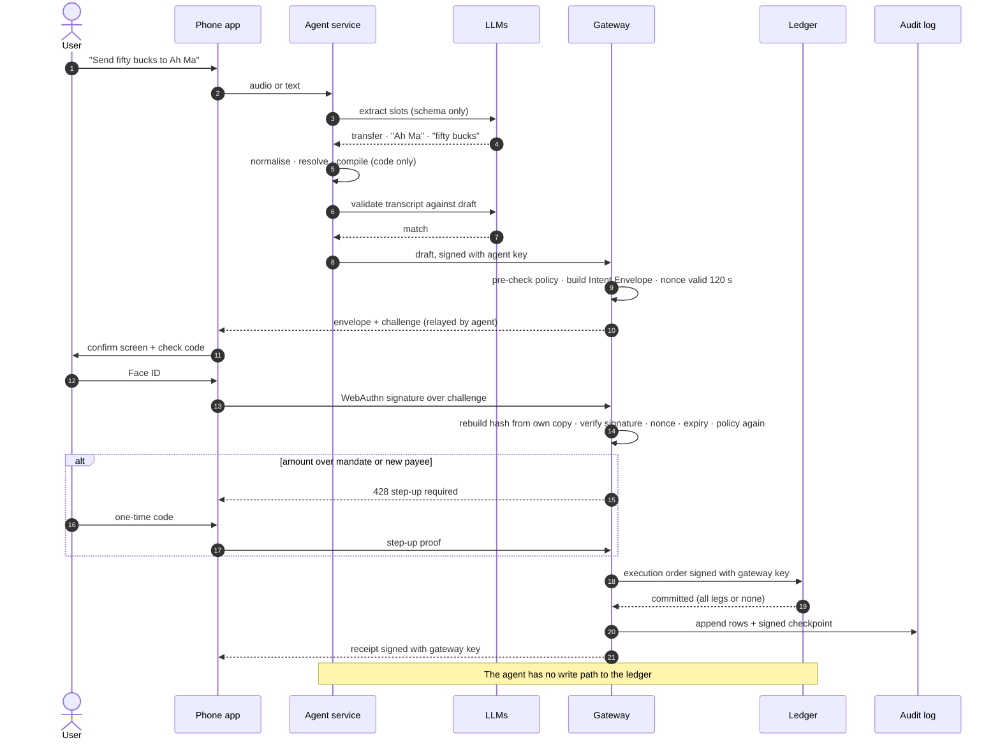

# DCTA Architecture

Three views of the same system. Interactive storyboard: see the *DCTA Demo Blueprint* artifact.

## 1. System map: trust zones, keys and data flow

## 2. Agent workflow: the LLM appears in two nodes only

Parallelogram nodes call an LLM. Every other node is plain Python.

## 3. Sign and execute: one payment end to end

