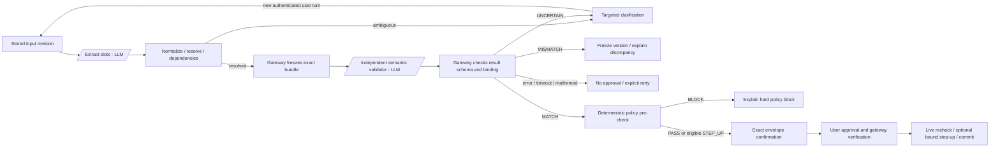
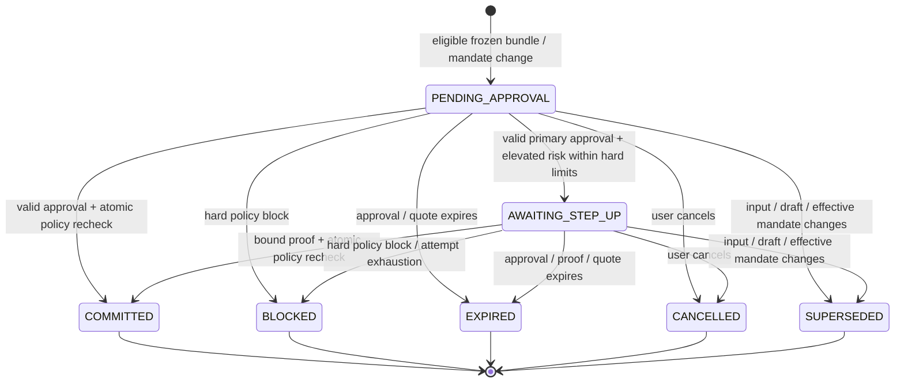

# DCTA v0.3 architecture

Design specification, revised 9 October 2026; these diagrams do not claim deployed functionality. Full MVP: transfers (own account/saved payee/saved PayNow), bills, cards, mock SGX equities and 1–4-leg bundles. **Langfuse is required.** See `PLAN.md` for contracts and `instructions.md` for implementation/acceptance tasks.

**Trust zones and data ownership**


The gateway alone owns ledger files and authoritative conversation/approval records. The agent cannot invent user turns, accept its own validation result, or write trusted gateway audit events. Internal calls use scoped service credentials and session/user binding. Validator responses are schema-checked evidence, not permission to execute. Neither LLM has payment tools. Container identities, mount permissions and API authorization establish the boundary; AST import tests alone do not.

All bank, KYC, sanctions, PayNow, equity and secondary-approval behavior is simulated. Real WebAuthn is the target, with the handbook's mock option retained only as an explicit contingency. Application UI, gateway deployment, identity store and authenticator are trusted assumptions. A prompt-injected model is in scope; a compromised gateway host/browser is not covered by the demonstrated guarantee.

**Conversation and validation decisions**



The validator reads full original turns, clarification questions, corrections and minimum bank metadata. It does not read extractor reasoning. It runs after a draft exists; “independent” does not mean both stages execute simultaneously. A MATCH only permits confirmation. An incorrect transcript may fool both models; display and correction remain necessary.

Every correction creates a revision and supersedes all associated pending validation/approval records. A changed quote or bundle creates a new draft and requires revalidation and reapproval. Metadata fields and provenance tags are not instructions, even when they came from a bank record. Inference remains probabilistic; policy and execution operate deterministically on fixed inputs/state.

**Approval lifecycle**



For a payment, transition to COMMITTED and all financial effects, nonce/proof consumption, counters, audit and receipt share one SQLite transaction. For a signed mandate change, COMMITTED means the requested policy update is recorded; an increase remains pending until its cooling time. Authenticated retries of an already committed identical operation return its receipt, not new execution. Invalid signatures leave no financial effects and are rate-limited/audited; they do not let an unrelated caller cancel another user's approval.

Hard-limit breaches are always BLOCK. Secondary approval cannot override mandate, KYC, ownership, sanctions, funds or velocity. During cooling the old mandate stays active; decreases/pauses cancel pending increases and invalidate pending payments. Any effective mandate-version change requires reapproval.

**Exact approval and execution sequence**

```mermaid
sequenceDiagram
  autonumber
  actor U as User
  participant UI as Client
  participant A as Agent
  participant G as Gateway
  participant V as Validator
  participant D as Gateway-owned database
  participant L as Langfuse

  U->>UI: Speak request and clarification/correction
  UI->>G: Authenticated input and audio evidence
  G->>D: Store original turns and revision
  G-->>A: Scoped snapshot reference
  A->>A: Extract, normalize, resolve via read APIs
  A->>G: Untrusted candidate bundle
  G->>D: Resolve and freeze immutable version
  G->>V: Stored conversation, bundle and bank metadata
  V-->>G: Structured semantic verdict
  G->>D: Store schema-checked result with hashes
  Note over G,V: Non-MATCH or error prevents challenge issuance
  UI->>G: Request approval envelope
  G->>G: Ownership and policy pre-check
  G->>D: Store canonical envelope, nonce, expiry, hash
  G-->>UI: Exact envelope and WebAuthn challenge
  UI->>U: All legs, accounts, totals and quote terms
  U->>UI: Approve through WebAuthn
  UI->>G: Authorization ID, expected hash, assertion
  G->>G: Verify identity, signature, freshness and bindings
  alt Elevated risk inside all hard limits
    G->>D: Persist AWAITING_STEP_UP, no financial effects
    G-->>UI: Simulated secondary approval required
    U->>UI: Code delivered through separate demo channel
    UI->>G: Authorization-bound secondary proof
  end
  G->>D: Begin write transaction and recheck state/policy
  G->>D: Apply all legs, consume approval, audit, receipt; commit
  G-->>UI: Persisted receipt
  G-->>L: Sanitized correlated observations
  Note over G,D: Reject atomically if any check fails; no partial payment
  Note over A,V: Both models may fail; neither can authorize execution
```

Signing formula: `SHA256(b"DCTA:approval:v1\x00" + canonical_bytes(SigningEnvelope))`. The envelope includes user, credential, operation, immutable full payload, conversation binding where applicable, active mandate version, nonce and expiry. One implementation issues and verifies it. The gateway executes stored bytes and ignores/rejects any attempt to replace the payload. WebAuthn user verification can use a PIN; ordinary WebAuthn does not make the React confirmation a browser-trusted payment display.

**Observability and evidence**

Langfuse is a real required backend: correlated traces across agent/validator/gateway, separate extraction/validation generations, prompt hashes, latency, available tokens/cost, sessions and dataset experiments. End observations before human waiting and link resumed turns by session/revision. Explicit allowlists exclude secrets, raw audio, assertions and unmasked account data. Trace IDs never grant access or establish authorization.

The gateway's prototype hash chain stores authoritative decisions and distinguishes untrusted agent event reports. Local audit failure rolls back payment. Langfuse outage reports degraded observability and triggers bounded sanitized export retry, but cannot relax controls or repeat a payment. The final submission must still include verified backend traces and experiment runs. A hash chain alone cannot prove resistance to privileged full rewriting or tail deletion; signed external checkpoints remain future work.

The MVP diagram intentionally shows no signed pack registry, agent-signed draft, gateway-signed ledger order or signed receipt. Those were unimplemented additions to the prior drawing; the full product features in PLAN remain unchanged. Recommendations are preserved in `PLAN_REVIEW.md` as optional future work.

**As built (10 Oct 2026)**

Where the implementation differs from the design above, or makes it more specific. The diagrams above are unchanged. Sources: the folder READMEs and `evidence/`.

- **Evidence-based lineage instead of model span references.**
  - The extractor returns quoted words only: no IDs, offsets or display names. The agent finds each quote verbatim in a current user turn and narrows it to words that name exactly one bank record.
  - The gateway (`gateway/evidence.py`) re-checks all three conditions: the location; that the words name exactly one record; and that cited amount words mean exactly the proposed amount (`shared/amounts.py`).
  - References and double-quoted text cannot supply critical fields. An ambiguous name ("John") is refused until the user disambiguates. The source account must also come from the user's words, so "send 15 to John" without a source gets a question ([E2E](evidence/E2E-live.md)).
- **Clarification questions are written by code** (`agent/questions.py`) from fixed text, the user's own words and gateway bank labels. They are never model text.
- **Orchestration route.**
  1. The browser calls `POST /api/conversations/{id}/draft`.
  2. The gateway mints a 120 s delegation token for that user and conversation, with exactly the scopes `conversation:read`, `bank:read`, `draft:freeze`, `conversation:propose_question` and `audit:append_agent`.
  3. It calls the agent's `/internal/run` with a `traceparent`. The proposal comes back through `/internal/drafts`, where the gateway freezes it.
  4. The gateway then runs the validation coordinator in-process, which calls the validator service over HTTP. The agent is re-run once if the revision went stale.
- **Timeouts and token budgets**, set from live measurements:

  | Setting | Value | Why |
  |---|---|---|
  | Gateway → agent (`AGENT_TIMEOUT_SECONDS`) | 45 s | Raised from 15 s after a live `hy3` turn took 17.4 s; 5 of the 35 T-14 runs exceeded 15 s, and the maximum was 29.0 s |
  | Validator model deadline (`VALIDATE_TIMEOUT_SECONDS`) | 30 s | |
  | Gateway's validator client | 40 s | |
  | Extractor client | 60 s | |
  | `EXTRACT_MAX_TOKENS`, `VALIDATE_MAX_TOKENS` | 4096 each | `hy3` reasons before answering; the validator budget was raised from 2048 after two empty outputs in T-14 |

  A validation error allows at most 3 attempts per draft and never becomes MATCH.
- **Validator input.**
  - The request is built by the gateway alone: the stored bundle bytes, the turns covered by the stored conversation hash, and bank labels including same-name candidates.
  - No balances are included, so the model cannot verify "the rest" (a T-14 finding).
  - A result is bound to the bundle, conversation, bank-label and input hashes. A changed bank label makes a MATCH ineligible.
- **Voice.**
  - Push-to-talk sentence ASR, not streaming. The browser uploads a 16 kHz mono WAV, and the gateway stores and digest-checks it before transcription.
  - No route accepts client-supplied ASR text.
  - The user's own saved payee names, aliases and billers are passed to TRTC as `hotword_list` (sanitized, at most 30 words). Without them "Ah Ma" was heard as "Amma" ([T-12](evidence/T-12-voice.md)).
- **Step-up channel.** It is simulated by the gateway operator routes plus `scripts/operator_console.py`. These are enabled only when `OPERATOR_TOKEN` (at least 32 characters) is set, and they refuse user sessions and agent tokens. The step-up challenge expires with the signed envelope (120 s or less).
- **Approval UI.** Approval happens in the chat's confirmation, and there is no separate Approve page. It signs the WebAuthn options derived from the stored envelope. Passkeys must be discoverable (resident) credentials.
- **Langfuse.**
  - Langfuse Cloud (US region), SDK 4.17. Read-back uses the v2 observations API, because the legacy trace API returns 410 for this organization.
  - The gateway's `ingest` span never exports turn text. Model generations export the model-visible data, with account IDs replaced by display labels.
- **Isolation.** Compose uses two bridge networks, `agent_net` and `validator_net`. Neither is `internal`, so both models keep outbound LLM egress, but the agent and validator cannot reach each other. Their root filesystems are read-only, only the gateway has the `/data` volume, and each container gets only its own LLM key ([T-04](evidence/T-04-isolation.txt)).
- **Usability baseline.** A conventional form at `#/baseline` (it makes no gateway calls), for the comparison study in `evals/usability/`.
- **Not built** (the same as stated above): signed pack registries, signed receipts, external audit checkpoints, Tencent APM, TTS and public hosting. The Rogue Agent Mode harness and attack matrix (T-13) are in progress.
