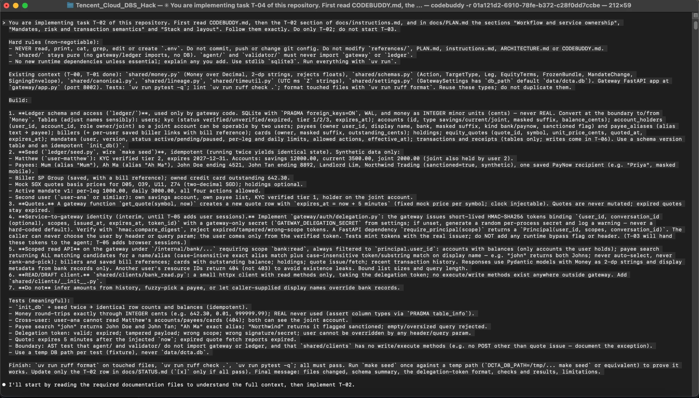
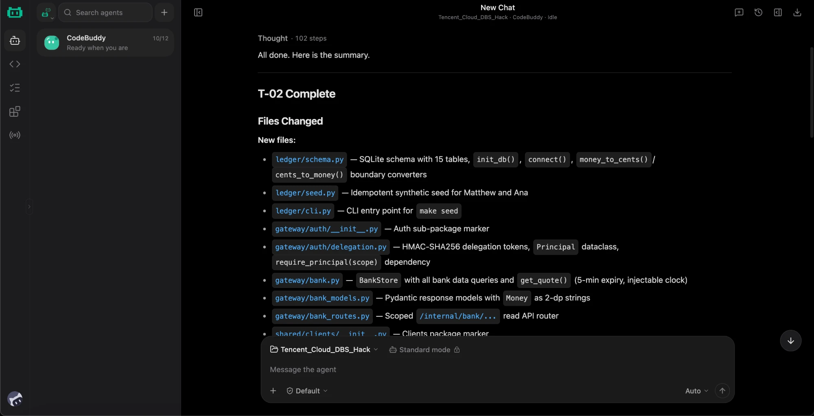
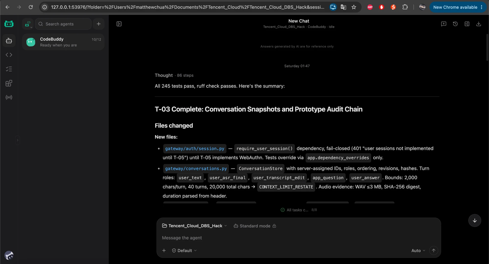

# docs/evidence/codebuddy: CodeBuddy development sessions (T-00 to T-05)

This folder is evidence of CodeBuddy use for the hackathon submission. It holds this session table and [EXCERPTS.md](EXCERPTS.md), which has short sanitized excerpts from each session. Three screenshots of the real sessions are in [`screenshots/`](screenshots/) (see "Screenshots"). Nothing in this folder contains credentials.

The figures were compiled on 10 Oct 2026 from the CodeBuddy CLI's own `stream-json` session logs, one JSONL file per run. A small Python script read them from those logs. The logs were not hand-edited, and no figure was estimated.

**Who built what.** CodeBuddy Code CLI 2.160.0 ran headless (`codebuddy -p`). It built T-00 to T-04 and most of T-05. On 10 Oct at 11:13 SGT its credits ran out (HTTP 429, "Credits exhausted"), and they will not reset before the deadline. From then on, Claude Code subagents built the remaining tasks (T-06 to T-15) and finished T-05. A lead Claude Code session, directed by the entrant, reviewed every task, CodeBuddy's included. It read each diff, re-ran the checks and fixed the defects listed in the Outcome column. Those fixes come from the lead session's status log.

## Sessions

Times are Singapore time (UTC+8). "Active" runs from the first logged event to the last tool call. "Turns" is the `num_turns` value the CLI reports in its result record. "Tool calls" counts every tool call in the log, including those of a CodeBuddy sub-agent when one was spawned (shown in brackets). "Files" counts repository files the session created (`Write`) or edited (`Edit`), not counting `docs/STATUS.md`.

| Task | Log file | Session ID | Start (SGT) | Active | Turns | Tool calls | Files | How it ended | Outcome, including reviewer fixes |
|---|---|---|---|---|---|---|---|---|---|
| T-00 scaffold and smoke scripts | `t00_codebuddy.jsonl` | `01a11fc9-971c-737e-b001-e4da0b27d30e` | 9 Oct 16:31 | 8 min | 223 | 93 | 38 created | success | Wrote the scaffold: `pyproject.toml`, `Makefile`, `.env.example` (placeholders), three FastAPI services with `/health`, per-service settings, the React/Vite skeleton, three smoke scripts and health tests. It ran in `acceptEdits` mode, so all 5 of its Bash calls were denied ("permission prompts are not available in non-interactive mode") and it ran nothing. The reviewer fixed the dependency pins and smoke scripts, then ran the checks and live smokes ([T-00-smoke.md](../T-00-smoke.md)). |
| T-01 schemas, lineage, signing envelope | `t01_codebuddy.jsonl` | `01a12189-df2a-7842-9d24-df5bb86becb0` | 10 Oct 00:40 | 13 min | 243 | 130 (sub-agent 33) | 11 | success, 129 tests passing | Built `shared/money.py`, `timeutil.py`, `schemas.py`, `lineage.py` and `canonical.py` (the single approval-challenge function) with tests. |
| T-01 fix round (same session, resumed) | `t01_fix_codebuddy.jsonl` | `01a12189-df2a-7842-9d24-df5bb86becb0` | 10 Oct 00:55 | 5 min | 9 | 37 | 5 | success, 138 tests passing | Made the three fixes the reviewer asked for: envelope↔bundle user and conversation binding, a `reference_text` lineage kind that can never supply a critical field, and pinned golden bytes. STATUS records 138 tests, with the challenge independently re-derived from the spec formula. |
| T-02 mock bank and scoped read APIs | `t02_codebuddy.jsonl` | `01a121b9-dede-7a33-92d8-7fe9d77bf63b` | 10 Oct 01:33 | 12 min | 252 | 147 (sub-agent 49) | 18 | success, 196 tests passing | Built the ledger schema and seed, HMAC delegation tokens, the user-scoped `/internal/bank/*` API, a read-only client and an AST isolation test. Reviewer fixes: SQL `LIKE` wildcards escaped; weak or placeholder delegation secrets rejected (202 tests). |
| T-03 conversations and audit chain | `t03_codebuddy.jsonl` | `01a121c6-fcc8-7d4e-b602-9a842d6a6982` | 10 Oct 01:47 | 10 min | 234 | 95 | 9 | success, 245 tests passing | Built the append-only conversation store (revisions, hashes, size limits, audio evidence) and the hash-chained audit log. Reviewer fixes: agent audit events bound to the token's conversation and owner; `append_audit` refuses to run outside a transaction; canonical payloads; the impersonation test made real (249 tests). |
| T-04 runtime isolation | `t04_codebuddy.jsonl` | `01a121d2-6910-78fe-b372-c28f0dd7ccbe` | 10 Oct 02:00 | 18 min | 293 | 172 (sub-agent 61) | 6 | error: `502` network failure (`getaddrinfo ENOTFOUND www.codebuddy.ai`) at 03:16, after resume attempts; its last tool call was at 02:18 | Built the Dockerfile, Compose file, in-container probe and a Compose test. It ran the probe itself: first 25/26 (its own `/health` was refused before start-up), then 26/26 in both containers, with 271 tests passing. Reviewer fixes: each container gets only its own LLM key (plus a test); `make isolation-probe` fails on any FAIL or on a `.env` in an image; the health wait uses `up --wait`. Re-run: 26/26 per container, 274 tests ([T-04-isolation.txt](../T-04-isolation.txt)). |
| T-05 plan (plan mode) | `t05_codebuddy.jsonl` | `01a123b0-0c45-7b50-a956-3130c78cb558` | 10 Oct 10:41 | 13 min | 139 | 146 | 8 | success, but `ExitPlanMode` was denied in headless mode | Read the `webauthn` library source, then wrote `gateway/identity.py`, `identity_routes.py`, `cli_enroll.py` and the approval hooks. It also wrote a 9-item implementation plan to its own plans folder (`~/.codebuddy/plans/`, outside the repository). |
| T-05 implementation (same session, resumed) | `t05b_codebuddy.jsonl` | `01a123b0-0c45-7b50-a956-3130c78cb558` | 10 Oct 10:55 | 19 min | 153 | 138 | 20 | error: `429 Credits exhausted` at 11:13 | Built sessions, `drafts.py`, `draft_routes.py`, a software passkey for tests, four T-05 test files and the first sign-in/approve pages. Its last full run (11:11) had 297 tests passing, and it was fixing an equity-leg test when credits ran out. The reviewer finished T-05: fail-closed issuance, credential ownership, single-use approval under a write lock, a bad assertion that no longer cancels, revision and mandate supersession, the operation fixed server-side, evidence-based lineage (`gateway/evidence.py`), equity quote checks and token↔conversation binding. The reviewer also replaced CodeBuddy's Approve page, which signed a login challenge instead of the envelope and did not show amounts. |
| Phase 5 progress and recovery (improvement plan) | `phase5_codebuddy.jsonl` (prompt `phase5_prompt.md`) | `01a130da-a414-7dda-ad70-6e589db2854a` | 13 Oct 00:03 | under 1 min of model time | 29 | 29 (2 sub-agents) | 0 | error: `429 Credits exhausted`, on model `gpt-6-astra` | Credits were briefly available again on 13 Oct (a one-word probe succeeded). It read the improvement plan, `CODEBUDDY.md` and the frontend, created a four-item task list and started two exploration sub-agents, then ran out of credits before editing any file. Phase 5 was then implemented by Codex (`gpt-6.1-sol`) from the same prompt and reviewed by the lead session. |

**Totals:** 8 logged runs in 6 CodeBuddy sessions, about 97 minutes of active work and 958 tool calls. CodeBuddy created or edited 92 repository files. 91 still exist, though most were revised later in review and in later tasks. `web/src/components/Approve.tsx` was removed. Tools it used: Read, Write, Edit, Bash, Glob, Grep, its task list (TaskCreate/TaskUpdate/TaskList), a sub-agent (Agent) for codebase surveys in T-01, T-02 and T-04, and plan mode (EnterPlanMode/ExitPlanMode) in T-05. The logs report the model only as `default-model`.

## What CodeBuddy was good at, and what review caught

- **Fast, broad scaffolding from a written spec.** Each task prompt pointed CodeBuddy at `CODEBUDDY.md`, `docs/PLAN.md` and the task's acceptance checks. Each session opened by reading those files, made a task list and finished with `ruff` and `pytest` runs.
- **It ran its own checks when allowed.** T-01 to T-05 ran with `bypassPermissions` and executed tests, lint, seeding and Docker probes. T-00 ran with `acceptEdits` and could not.
- **Security details needed a second reader.** Every CodeBuddy task needed at least one reviewer fix, and all of these were authorization or binding gaps that its tests had not covered (see the table). The most serious: the first Approve page signed the wrong challenge and hid the amounts.
- **Headless limits.** Plan mode cannot be exited without an interactive prompt, so the T-05 plan had to be run in a second, resumed invocation.

## Screenshots

The handbook (p. 37) asks for "a minimum of 3 screenshots/screen recording of your chat logs from CodeBuddy or WorkBuddy during the development process". These are captures of CodeBuddy's own interfaces showing the saved sessions; they are not mock-ups or replays.

| Screenshot | What it shows |
|---|---|
|  | **CLI** (`codebuddy -r`): the restored history opens with the lead's T-02 task prompt (hard rules, the ledger, seed, delegation-token and read-API spec, and the required tests), and CodeBuddy's first reply. |
|  | **Web UI** (`codebuddy --serve --open`): the end of the T-02 session after 102 steps: "T-02 Complete", with the files it created (`ledger/schema.py`, `ledger/seed.py`, `gateway/auth/delegation.py`, `gateway/bank_routes.py`, ...). |
|  | **Web UI**: the end of the T-03 session after 86 steps: "All 245 tests pass, ruff check passes", then the conversation store and audit-chain summary. |

**Raw logs** are in [`logs/`](logs/): the eight CodeBuddy CLI stream-json transcripts plus the exact prompts the lead sent. Every key-like string in them is a `.env.example` placeholder, and none of the owner's configured secret values appears anywhere in the repository.
